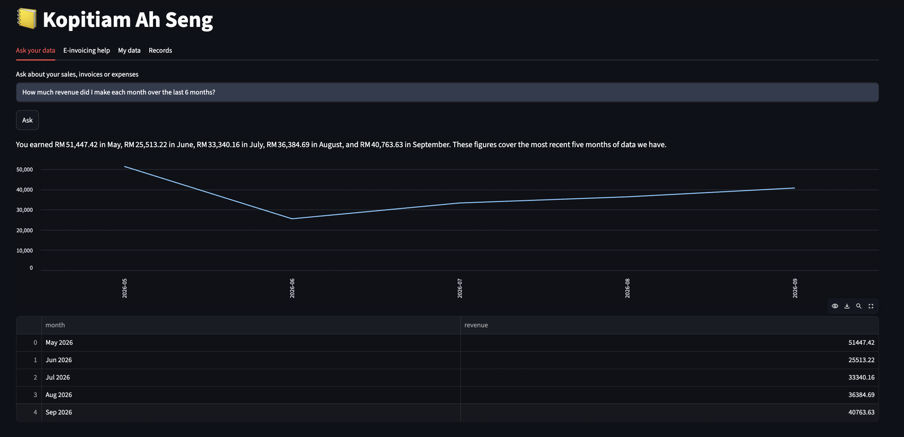
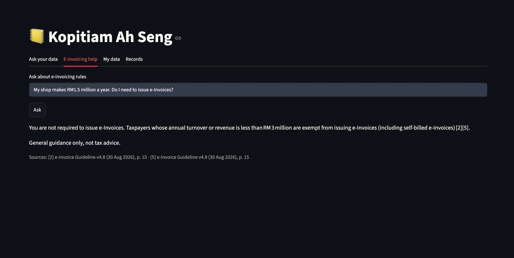
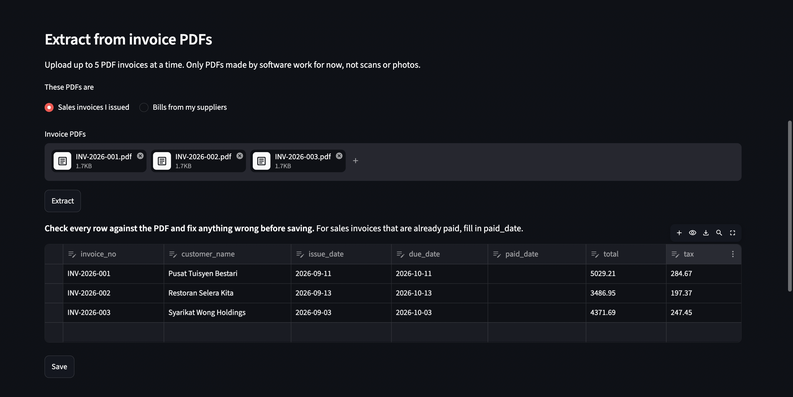
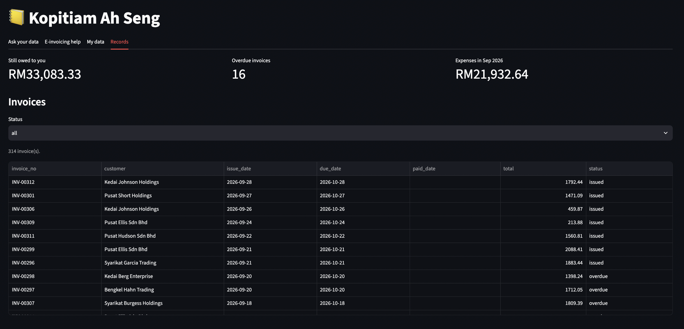
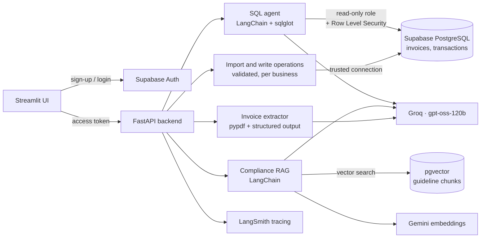

# AI Finance Copilot for Malaysian SMEs

An AI assistant that lets Malaysian small business owners load their invoices and expenses, ask questions about their own finances in plain English, and get e-invoicing answers drawn from the official LHDN guidelines with page citations.

**Live app:** [STREAMLIT-APP-LINK](STREAMLIT-APP-LINK)
**Demo login:** `DEMO-EMAIL` / `DEMO-PASSWORD` (read-only, preloaded with a year of sample data)
**API documentation:** [ai-finance-copilot-for-malaysian-smes.onrender.com/docs](https://ai-finance-copilot-for-malaysian-smes.onrender.com/docs)

> The backend runs on a free tier that sleeps when idle, so the first request may take up to a minute. To try the app with your own data, sign up and upload the sample files in [`demo/`](demo/).



---

## Contents

- [The problem](#the-problem)
- [Features](#features)
- [Screenshots](#screenshots)
- [Architecture](#architecture)
- [Safety and data isolation](#safety-and-data-isolation)
- [Results](#results)
- [Tech stack](#tech-stack)
- [API endpoints](#api-endpoints)
- [Project structure](#project-structure)
- [Getting started](#getting-started)
- [Lessons learned](#lessons-learned)
- [Limitations](#limitations)
- [Roadmap](#roadmap)

---

## The problem

Malaysian small business owners face two recurring problems:

1. **Limited visibility into their own numbers.** Questions such as *"Who still owes me money?"* or *"Are my utility bills rising?"* typically require filtering spreadsheets by hand or waiting for an accountant, so late payers and rising costs are noticed too late.
2. **Uncertainty about e-invoicing.** LHDN is rolling out e-invoicing in phases, and the rules are spread across two long technical guidelines. Many owners are unsure whether the rules apply to them yet, which exemptions they qualify for, and how specific situations, such as cancelling a validated e-Invoice, are handled.

## Features

| Area | What it does |
|---|---|
| **Accounts** | Self-service sign-up and business setup. Each account sees only its own business's data. |
| **Data import** | CSV upload for invoices and expenses, with templates. Every row is validated before anything is saved, and re-uploading the same file never creates duplicates. |
| **Invoice PDF extraction** | Upload sales invoices or supplier bills as PDFs. The AI extracts the key fields into an editable table, and nothing is saved until the user has reviewed it. Documents that are not invoices are rejected. |
| **Records** | View all saved invoices and expenses, with totals owed, overdue invoices and this month's expenses. Mark invoices as paid, add single invoices, or delete all data. |
| **Ask your data** | Plain-English questions are answered by a text-to-SQL agent that writes a safe query, runs it on the user's data only, and explains the result, with an automatic chart and the query shown for transparency. |
| **E-invoicing help** | Answers come only from the two official LHDN e-Invoice guidelines, with the source and page for each claim. Off-topic questions are declined. |

## Screenshots

| Ask your data | E-invoicing help |
|---|---|
|  |  |

| Invoice PDF review | Records |
|---|---|
|  |  |

## Architecture



**SQL agent.** The language model turns a question into a single SQL query, guided by a schema description and worked examples. sqlglot rejects anything other than one `SELECT` on four approved tables and adds a row limit. The query runs under a read-only database role with Row Level Security and a five-second timeout. If it fails, the error is returned to the model to correct, up to two retries, and the model then explains the result in plain language.

**Compliance RAG.** The e-Invoice Guideline (version 4.8) and e-Invoice Specific Guideline (version 4.9) are split into 348 chunks and embedded with Gemini at 1,536 dimensions into pgvector. Each question retrieves the five most similar chunks, and the model answers using only those passages, citing each one.

**Invoice extraction.** Text is extracted from up to three pages of a PDF, and the model fills a fixed schema: invoice number, customer or supplier, issue date, due date, total and tax. Extracted rows pass through the same validation as CSV imports before they can be saved.

## Safety and data isolation

Three independent layers stop the AI from reading or changing data it should not:

- **The model** is instructed to decline requests to add, change or delete data, and questions the data cannot answer. Declines return a short fixed message rather than raw model output.
- **The validator** (sqlglot) permits only a single `SELECT` on approved tables, with a row limit.
- **The database** runs AI queries under a role with `SELECT`-only permissions, and Postgres Row Level Security restricts every query to the logged-in business. A query with no business filter still returns only that business's rows.

All writes go through validated backend operations scoped to the authenticated business. The public demo account is read-only: every endpoint that saves data rejects it on the server.

## Results

| Component | Evaluation | Result |
|---|---|---|
| **Invoice PDF extraction** | Six fields per invoice compared against ground truth, across ten synthetic invoices: five sales invoices and five supplier bills | **100% field-level accuracy** (60 of 60 fields) |
| **SQL agent** | Hand-tested on representative questions, plus safety tests for data modification, cross-business access and system tables | All safety tests blocked; not formally benchmarked |
| **Compliance RAG** | Hand-tested on exemptions, cancellation, consolidated e-Invoices and an off-topic question | Answers checked against cited pages; not formally benchmarked |

The extraction test set shares a single clean layout, so it confirms the pipeline works end to end rather than measuring robustness to varied real-world invoices. Details are in [`eval/results.md`](eval/results.md), and the test set can be regenerated with `data/make_sample_invoices.py`.

## Tech stack

| Layer | Technology | Purpose |
|---|---|---|
| LLM orchestration | LangChain | Chat models, structured output, embeddings |
| Chat model | Groq · `openai/gpt-oss-120b` | SQL generation, explanations, cited answers, field extraction |
| Embeddings | Google Gemini `gemini-embedding-001` | 1,536-dimension vectors for guideline chunks and questions |
| Backend | FastAPI | Authenticated REST API |
| Database | Supabase PostgreSQL | Businesses, customers, invoices and transactions |
| Vector search | pgvector | Similarity search over guideline chunks |
| Authentication | Supabase Auth | Sign-up, login and access tokens |
| Data isolation | Row Level Security, read-only role | Restricting AI queries to one business |
| SQL validation | sqlglot | Allowing only safe, single `SELECT` statements |
| Data processing | pandas, pypdf | CSV parsing, PDF text extraction |
| Frontend | Streamlit | User interface |
| Observability | LangSmith | Tracing latency and token usage per call |
| Testing and linting | pytest, Ruff | Unit and API tests, code quality |
| CI | GitHub Actions | Lint and test on every push |
| Containerisation | Docker | Packaging the backend |
| Hosting | Render, Streamlit Community Cloud | Backend and frontend |

## API endpoints

Interactive documentation is available at [`/docs`](https://ai-finance-copilot-for-malaysian-smes.onrender.com/docs). Every endpoint except `/health` requires a Supabase access token: `Authorization: Bearer <token>`. Endpoints marked *write* are rejected for the read-only demo account.

| Method | Endpoint | Description |
|---|---|---|
| `GET` | `/health` | Health check |
| `GET` | `/me` | The current user's business, with a `read_only` flag |
| `POST` | `/business` | Create the business for a newly signed-up user |
| `POST` | `/chat/sql` | Answer a question about the business's own data |
| `POST` | `/chat/docs` | Answer an e-invoicing question from the LHDN guidelines |
| `GET` | `/records/invoices` | List saved invoices with customer names and status |
| `GET` | `/records/expenses` | List saved expenses |
| `POST` | `/import/csv/{kind}` | *Write.* Import invoices or expenses from a CSV file |
| `POST` | `/extract/invoice` | Extract fields from an invoice or bill PDF for review |
| `POST` | `/import/rows` | *Write.* Save reviewed rows from PDF extraction or quick add |
| `POST` | `/invoices/{invoice_no}/paid` | *Write.* Mark an invoice as paid |
| `DELETE` | `/data` | *Write.* Delete all of the business's data |

Example request for both chat endpoints:

```json
{ "question": "Which customers paid late most often this year?" }
```

## Project structure

```
backend/
  app/
    agents/
      sql_agent.py           Text-to-SQL agent with guardrails and self-correction
      rag_chain.py           Retrieval and cited answers over the LHDN guidelines
      invoice_extractor.py   PDF field extraction with structured output
    auth.py                  Token verification, business lookup, read-only checks
    data_ops.py              CSV validation, imports and other write operations
    db.py                    Trusted and read-only database helpers
    llm.py                   Shared chat-model factory
    main.py                  FastAPI routes
  tests/                     API, guardrail and import validation tests
frontend/streamlit_app.py    User interface
data/
  seed.py                    Synthetic demo data
  ingest_docs.py             Chunk, embed and store the guidelines
  make_sample_invoices.py    Sample invoice PDFs and their ground truth
demo/                        Sample CSVs and invoice PDFs for trying the app
eval/                        Extraction evaluation script and results
sql/                         Schema, read-only role and Row Level Security policies
```

## Getting started

**Requirements:** Python 3.12 or later, a Supabase project, and free API keys for Groq, Google AI Studio and LangSmith.

1. **Clone and install**
   ```bash
   git clone https://github.com/ambergiselle/sme-finance-copilot.git
   cd sme-finance-copilot
   python -m venv .venv && source .venv/bin/activate
   pip install -r backend/requirements.txt
   ```
2. **Configure.** Copy `.env.example` to `.env` and fill in the Supabase URL and anon key, the `DATABASE_URL` and read-only `AGENT_DATABASE_URL` connection strings, and the Groq, Google and LangSmith keys.
3. **Set up the database.** In the Supabase SQL Editor, run `sql/schema.sql`, `sql/agent_role.sql` and `sql/policies.sql`. Under Authentication, enable new sign-ups.
4. **Load data.** Download the two LHDN e-Invoice guidelines into `data/docs/`, then run:
   ```bash
   python data/seed.py
   python data/ingest_docs.py
   ```
5. **Start the backend**
   ```bash
   cd backend && uvicorn app.main:app --reload
   ```
6. **Start the frontend.** In a second terminal, create `frontend/.streamlit/secrets.toml` containing `SUPABASE_URL`, `SUPABASE_ANON_KEY` and `API_URL = "http://127.0.0.1:8000"`, then run:
   ```bash
   pip install -r frontend/requirements.txt
   cd frontend && streamlit run streamlit_app.py
   ```
7. **Run the checks** from `backend/`:
   ```bash
   ruff check .
   pytest
   ```

## Lessons learned

- **Worked examples outperform written rules.** The model ignored a written rule defining a late payment as more than seven days overdue and returned all 29 customers. One worked example query fixed it, returning the three chronic late payers in the data.
- **A model should say what the data cannot answer.** Asked *"Who do I owe?"*, the agent quietly answered from receivables, because the app does not track payables. The fix was teaching it to decline that question rather than reinterpret it.
- **Refusals can break structured output.** When asked to delete data, the model refused in plain text instead of returning the required structured response, so the API rejected it and the agent retried pointlessly. An explicit refusal field and a fixed fallback message resolved this. An earlier fallback echoed raw model text to the user, which is why fallback messages are now fixed.
- **Test with inputs that should fail.** Uploading a CV to the invoice extractor produced an empty review row. An explicit "is this an invoice" check now rejects such documents.
- **Partial failures can leave nothing behind.** Embedding the guidelines hit Gemini's free-tier limit of 100 requests per minute, and the transaction rolled back, leaving the vector table empty. Ingestion now embeds in batches and writes only after every embedding succeeds.
- **Keep the model provider swappable.** Gemini's free-tier rate limits were too tight for an agent that makes several calls per question, so chat moved to Groq while embeddings stayed on Gemini. A single model factory made the switch a configuration change.
- **Token limits matter more than request limits.** Groq's free tier allows 30 requests but only 8,000 tokens per minute, so the agent sends a 20-row preview with the true row count rather than every row, and uses low reasoning effort.
- **Verify what is actually deployed.** A sign-up bug on the live site turned out to be the server running an older authentication module than the local code. The request logs, showing 403 instead of the expected 404, identified the mismatch.

## Limitations

- **Data import:** PDF extraction reads one invoice per file, supports digital PDFs only (not scans or photos), and assumes amounts in RM and day-first dates. Invoices in other currencies or US date formats must be corrected in the review table.
- **Scope of data questions:** the app tracks money customers owe the business, not money the business owes suppliers. Each question is answered either from business data or from the guidelines, not both.
- **Scope of compliance answers:** only the two e-invoicing guidelines are covered, not income tax, SST or other regulations.
- **Evaluation:** extraction was measured on a small synthetic set of one layout; the SQL agent and compliance answers were hand-tested rather than formally benchmarked.
- **Capacity:** free-tier LLM limits allow roughly 60 to 100 questions a day.

## Roadmap

- Payables: tracking unpaid supplier bills
- Multi-invoice PDFs, currency detection and scanned invoice support
- Formal benchmarks for the SQL agent and compliance answers
- Automatic routing between data and e-invoicing questions
- Bahasa Malaysia support

---

All demo data is synthetic. Compliance answers are general guidance only and do not constitute tax advice.
