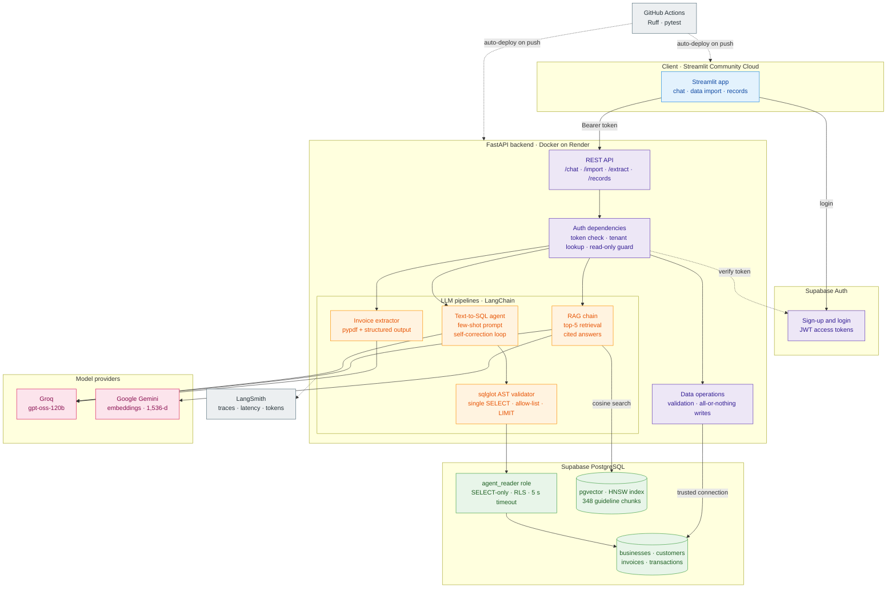

# AI Finance Copilot for Malaysian SMEs

**A multi-tenant AI finance assistant combining text-to-SQL, RAG and LLM document extraction**

AI Finance Copilot lets Malaysian small businesses query their financial data in plain English and get cited answers on LHDN e-invoicing rules. It combines a **text-to-SQL agent** with query validation and self-correction, a **RAG pipeline** over the official guidelines using pgvector semantic search, and **structured-output extraction** of invoice PDFs with human review before saving. PostgreSQL Row Level Security and a read-only database role keep each business's data isolated and protected from AI-generated queries. Built with FastAPI, LangChain, Supabase and Streamlit, and deployed with Docker, CI and LangSmith tracing.


## Live Demo

Try the deployed app: **[Live Demo](https://ai-finance-copilot-malaysian-sme.streamlit.app/)**

| | |
|---|---|
| **Demo login** | `user@email.com` / `123456` |
| **Access** | Read-only, preloaded with a year of sample data for a Malaysian kopitiam |
| **Your own data** | Sign up, then upload the sample files in [`demo/`](demo/) |
| **API Documentation** | [Swagger UI](https://ai-finance-copilot-for-malaysian-smes.onrender.com/docs) |

---
## Features

| Area | What it does |
|---|---|
| **Accounts** | Self-service sign-up and business setup. Each account sees only its own business's data. |
| **Data import** | CSV upload for invoices and expenses, with templates. Every row is validated before anything is saved, and re-uploading the same file never creates duplicates. |
| **Invoice PDF extraction** | Upload sales invoices or supplier bills as PDFs. The AI extracts the key fields into an editable table, and nothing is saved until the user has reviewed it. Documents that are not invoices are rejected. |
| **Records** | View all saved invoices and expenses, with totals owed, overdue invoices and this month's expenses. Mark invoices as paid, add single invoices, or delete all data. |
| **Ask your data** | Plain-English questions are answered by a text-to-SQL agent that writes a safe query, runs it on the user's data only, and explains the result, with an automatic chart and the query shown for transparency. |
| **E-invoicing help** | Answers come only from the two official LHDN e-Invoice guidelines, with the source and page for each claim. Off-topic questions are declined. |
## Architecture



| Component | How it works | Safeguards |
|---|---|---|
| **SQL agent** | The model turns a question into one SQL query, guided by a schema description and worked examples, then explains the result in plain language. | sqlglot allows only a single `SELECT` on four approved tables, with a row limit. Queries run under a read-only role with Row Level Security and a five-second timeout. Failed queries are returned to the model to correct, up to two retries. |
| **Compliance RAG** | The two LHDN guidelines (versions 4.8 and 4.9) are split into 348 chunks and embedded with Gemini at 1,536 dimensions into pgvector. Each question retrieves the five most similar chunks. | The model answers only from the retrieved passages, cites each one, and states when a question is not covered. |
| **Invoice extraction** | Text from up to three PDF pages is passed to the model, which fills a fixed schema: invoice number, customer or supplier, dates, total and tax. | Non-invoices are rejected. Extracted rows pass the same validation as CSV imports, and nothing is saved until the user has reviewed it. |

## Screenshots

### Ask your data


### E-invoicing Help
 

### Invoice PDF Review


### Records
 


## Results

| Component | Result |
|---|---|
| Invoice PDF extraction | 100% field accuracy on 10 synthetic invoices |
| SQL agent safety tests | All blocked: data changes, cross-business access, system tables |
| Compliance answers | Hand-tested with page citations; not formally benchmarked |

Details in [`eval/results.md`](eval/results.md).

## Tech stack

| Layer | Technology | Purpose |
|---|---|---|
| LLM orchestration | LangChain | Chat models, structured output, embeddings |
| Chat model | Groq · `openai/gpt-oss-120b` | SQL generation, explanations, cited answers, field extraction |
| Embeddings | Google Gemini `gemini-embedding-001` | 1,536-dimension vectors for guideline chunks and questions |
| Backend | FastAPI | Authenticated REST API |
| Database | Supabase PostgreSQL | Businesses, customers, invoices and transactions |
| Vector search | pgvector | Similarity search over guideline chunks |
| Authentication | Supabase Auth | Sign-up, login and access tokens |
| Data isolation | Row Level Security, read-only role | Restricting AI queries to one business |
| SQL validation | sqlglot | Allowing only safe, single `SELECT` statements |
| Data processing | pandas, pypdf | CSV parsing, PDF text extraction |
| Frontend | Streamlit | User interface |
| Observability | LangSmith | Tracing latency and token usage per call |
| Testing and linting | pytest, Ruff | Unit and API tests, code quality |
| CI | GitHub Actions | Lint and test on every push |
| Containerisation | Docker | Packaging the backend |
| Hosting | Render, Streamlit Community Cloud | Backend and frontend |

## API Endpoints

Interactive documentation is available at [`/docs`](https://ai-finance-copilot-for-malaysian-smes.onrender.com/docs).
\
Every endpoint except `/health` requires a Supabase access token: `Authorization: Bearer <token>`. 
\
Endpoints marked *write* are rejected for the read-only demo account.

| Method | Endpoint | Description |
|---|---|---|
| `GET` | `/health` | Health check |
| `GET` | `/me` | The current user's business, with a `read_only` flag |
| `POST` | `/business` | Create the business for a newly signed-up user |
| `POST` | `/chat/sql` | Answer a question about the business's own data |
| `POST` | `/chat/docs` | Answer an e-invoicing question from the LHDN guidelines |
| `GET` | `/records/invoices` | List saved invoices with customer names and status |
| `GET` | `/records/expenses` | List saved expenses |
| `POST` | `/import/csv/{kind}` | *Write.* Import invoices or expenses from a CSV file |
| `POST` | `/extract/invoice` | Extract fields from an invoice or bill PDF for review |
| `POST` | `/import/rows` | *Write.* Save reviewed rows from PDF extraction or quick add |
| `POST` | `/invoices/{invoice_no}/paid` | *Write.* Mark an invoice as paid |
| `DELETE` | `/data` | *Write.* Delete all of the business's data |

## Getting started

### Prerequisites

- Python 3.12+
- A [Supabase](https://supabase.com/) project (free tier available)
- A [Groq API key](https://console.groq.com/) (free tier available)
- A [Google AI Studio API key](https://aistudio.google.com/) for Gemini embeddings (free tier available)
- A [LangSmith API key](https://smith.langchain.com/) for tracing (optional)

### Setup

```bash
# Clone the repository
git clone https://github.com/ambergiselle/sme-finance-copilot.git
cd sme-finance-copilot

# Create a virtual environment and install dependencies
python -m venv .venv && source .venv/bin/activate
pip install -r backend/requirements.txt -r frontend/requirements.txt

# Copy the environment file and add your keys
cp .env.example .env
```

### Database

1. In the Supabase SQL Editor, run `sql/schema.sql`, `sql/agent_role.sql` and `sql/policies.sql`.
2. Under **Authentication**, enable new user sign-ups.
3. Download the two [LHDN e-Invoice guidelines](https://www.hasil.gov.my/en/e-invoice/) into `data/docs/`, then load the data:

```bash
python data/seed.py          # synthetic demo businesses
python data/ingest_docs.py   # embed the guidelines into pgvector
```

### Run

```bash
# Terminal 1: backend
cd backend && uvicorn app.main:app --reload

# Terminal 2: frontend (add your Supabase keys to frontend/.streamlit/secrets.toml first)
cd frontend && streamlit run streamlit_app.py
```

| Service | URL |
|---|---|
| Streamlit frontend | http://localhost:8501 |
| FastAPI backend | http://localhost:8000 |
| Swagger docs | http://localhost:8000/docs |

### Run tests

```bash
cd backend
pytest
ruff check .
```
## Project Structure

```
sme-finance-copilot/
├── backend/                          # FastAPI service, Docker on Render
│   ├── app/
│   │   ├── main.py                   # API routes and request models
│   │   ├── config.py                 # pydantic-settings configuration
│   │   ├── auth.py                   # Token check, tenant lookup, read-only guard
│   │   ├── db.py                     # Trusted and read-only (RLS) database helpers
│   │   ├── llm.py                    # Shared chat-model factory
│   │   ├── data_ops.py               # CSV validation, imports and writes
│   │   └── agents/                   # LLM pipelines
│   │       ├── sql_agent.py          # Text-to-SQL agent, guardrails, self-correction
│   │       ├── rag_chain.py          # Retrieval and cited answers
│   │       └── invoice_extractor.py  # PDF extraction with structured output
│   ├── tests/                        # pytest suites
│   │   ├── test_api.py               # API and read-only demo tests
│   │   ├── test_guardrails.py        # SQL validator tests
│   │   └── test_data_ops.py          # CSV validation tests
│   ├── Dockerfile                    # Backend container
│   └── requirements.txt              # Backend dependencies
├── frontend/                         # Streamlit app on Community Cloud
│   ├── streamlit_app.py              # Chat, data import, PDF review, records
│   └── requirements.txt              # Frontend dependencies
├── data/
│   ├── seed.py                       # Synthetic demo businesses
│   ├── ingest_docs.py                # Chunk and embed the LHDN guidelines
│   ├── make_sample_invoices.py       # Sample invoice PDFs and ground truth
│   └── docs/                         # LHDN guideline PDFs (download separately)
├── demo/                             # Sample CSVs and PDFs for trying the app
├── eval/                             # Extraction evaluation script and results
├── sql/                              # Schema, read-only role, RLS policies
├── scripts/                          # Helper for getting a test token
├── .github/workflows/                # CI: Ruff and pytest
├── .env.example                      # Environment variable template
└── README.md
```